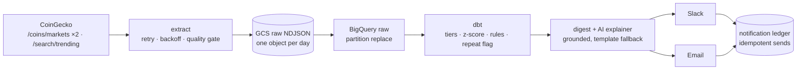

# cryptowatch — daily crypto alert digest (Airflow · BigQuery · dbt · AI explainer)

Fetches enriched market data from CoinGecko once a day, applies tiered alert rules, and delivers one
digest to Slack and email at 08:00 Lagos time. A batch pipeline on purpose: one snapshot, three API calls,
fully replayable from the landed raw data.



## Business logic

| Rule | Fires when | Why it is built this way |
|---|---|---|
| `PRICE_MOVE` | `\|24h change\| ≥` tier threshold **and** 24h volume ≥ tier floor | One ±85% threshold would never fire on large caps, so thresholds are per market-cap tier (LARGE 20 · MID 35 · SMALL 50 · MICRO 85, in `seeds/alert_thresholds.csv`). The volume floor drops moves in thin markets, where a 150% jump is usually noise |
| `NEWLY_TRENDING` | On CoinGecko's trending list today, absent for the previous 7 days | "Trending" is a state, so only the *entry* alerts |
| `NEW_IN_UNIVERSE` | First time seen in the top 500 | The new-listings endpoint is paid-only. Snapshot diff is the free-tier substitute; HIGH confidence when the coin's all-time low is under 30 days old, MEDIUM when it merely climbed into the top 500 |

Every alert carries price, 24h and 7d change, market cap and rank, timestamp, coin logo and CoinGecko link,
a severity, a priority score and a 30-day z-score (how unusual this move is for *that* coin).
A repeat of the same coin and rule within 3 days is stored but not re-notified (the digest says "N continuing").
An empty day still sends a short "all quiet" message, so silence always means "broken", never "nothing happened".

## Technology choices

* **Python for extraction, dbt + BigQuery for transformation, Airflow for orchestration.** The data is ~500 rows a day, so PySpark would add cost and failure modes for no benefit; Spark is the right call at millions of rows, and the same dbt models would sit behind it unchanged.
* **Daily batch limits are explicit:** a move that reverses inside a day is invisible, and the free API serves current data only, so past days cannot be rebuilt from the API (the DAG refuses rather than stamping today's prices with an old date; days already landed can be re-processed).
* **AI is an explainer, not a decision-maker.** One sentence of context per alert (top 10 by priority). The model never sees real identifiers or instructions it could follow: coin names are sanitised and treated as data; its output must contain only numbers traceable to the facts, no advice, no links; otherwise a deterministic template is used.

## Verified here (no cloud, no network)

`bash scripts/run_local_e2e.sh` generates 10 days of CoinGecko-shaped payloads with injected events, pushes them through the real extractor code and quality gate, builds the dbt models and runs all 17 dbt tests on DuckDB, then checks `fct_alerts` against the ground truth by exact set equality: 7 of 7 expected alerts, none extra, the illiquid 150% spike not alerted, the trending coin seen during warm-up not alerted, and the repeat pump stored but not notified. 48 Python tests cover the client (retry, rate-limit, key in header), quality gate, idempotent extract, formatting, hostile coin names, grounding, channels and the delivery ledger; 4 more load the DAG in real Airflow.

## Run

```bash
pip install -r requirements-dev.txt
bash scripts/run_local_e2e.sh                       # end-to-end proof + preview files
pytest -q --ignore=tests/test_dag.py                # unit tests
pip install -r requirements-airflow.txt --constraint <airflow constraints url> && pytest tests/test_dag.py
```

## Deploy

1. `cd terraform/envs/dev && terraform init -backend-config=... && terraform apply -var project_id=...`
2. Put secret values in Secret Manager: `coingecko-demo-key`, `slack-webhook-url`, `smtp-config` (JSON `{host, port, user, password, from, to: []}`), `anthropic-api-key` (optional: without it explanations fall back to templates).
3. Copy `dags/` to the Composer bucket and `dbt/` to its `data/` folder; unpause `crypto_daily_digest`.
`BUCKET=$(gcloud composer environments describe crypto-dev-airflow --location europe-west1 \
  --format='value(config.dagGcsPrefix)' | sed 's#/dags##')
cd ../../..        # cryptowatch/ root
gcloud storage cp -r dags/* dags/.airflowignore $BUCKET/dags/
gcloud storage cp -r dbt/cryptowatch $BUCKET/data/dbt/
`
## Add a channel (WhatsApp, Telegram, ...)

Write a class with `name` and `send(digest) -> str` in `dags/cryptowatch/channels.py` (the Slack and email classes are the templates), add its secret and a branch in `send` in the DAG, and add the name to `CW_CHANNELS`. Formatting helpers, the ledger and retries come for free. WhatsApp needs an approved Business sender and message templates (Twilio or Meta Cloud API); Telegram is a single bot-API POST.

## Cost note

Composer is the right Airflow for production but is the most expensive line for a single daily DAG; ADR-008 covers the cheaper alternatives if cost matters more than managed Airflow.

When you're finished, `terraform destroy -var project_id=$PROJECT` removes everything and stops the Composer cost.