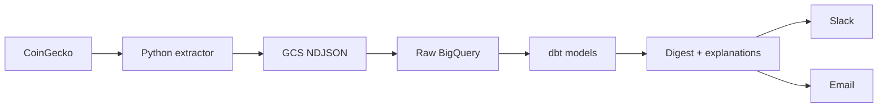

Think of this project as a daily automated crypto monitoring system:

**Where to start**

1. `README.md` describes the business purpose, rules, and deployment.
2. `crypto_daily_digest.py` is the Airflow orchestration entry point.
3. `tasks.py` contains the extraction and quality-check logic.
4. `fct_alerts.sql` contains the actual alert rules.
5. `delivery.py` prevents the same digest from being sent twice.
6. `ci.yml` shows how all parts are tested.

**One daily run**

At 08:00 Lagos time, Airflow:

1. Fetches top-500 market data and trending coins from CoinGecko.
2. Normalizes the responses and checks minimum row counts and data quality.
3. Stores the results as NDJSON files in Google Cloud Storage.
4. Loads those files into partitioned BigQuery raw tables.
5. Runs dbt to create staging tables and daily snapshot facts.
6. Applies three alert rules:
   - `PRICE_MOVE`: unusually large price move with sufficient trading volume.
   - `NEWLY_TRENDING`: coin newly appears on CoinGecko's trending list.
   - `NEW_IN_UNIVERSE`: coin appears in the top 500 for the first time.
7. Builds one digest containing priority-sorted alerts.
8. Optionally asks Anthropic for one grounded sentence per top alert.
9. Sends the digest through Slack and email.
10. Records delivery and pipeline success in BigQuery.

**Key separation of concerns**

- `crypto_daily_digest.py`: wiring and scheduling.
- `tasks.py`: extraction.
- `quality.py`: rejects bad or replay-impossible data.
- `models`: transformations and alert calculations.
- `digest.py`: combines alert rows into a digest.
- `explain.py`: AI explanations with deterministic fallback.
- `channels.py`: Slack/email integrations.
- `delivery.py`: idempotent notification ledger.
- `terraform`: creates the cloud infrastructure.
- `run_local_e2e.sh`: proves the pipeline locally using synthetic fixtures.

The most important design idea is replayability: extracted daily data is stored first, BigQuery partitions are replaced rather than appended, dbt rebuilds deterministically, and notification delivery has a ledger. Retrying a task should not silently create duplicate alerts or deliveries.